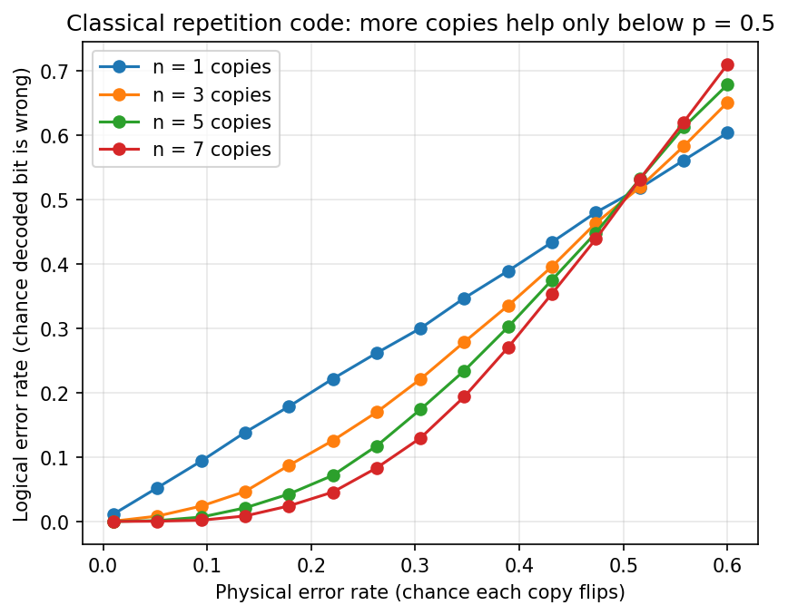
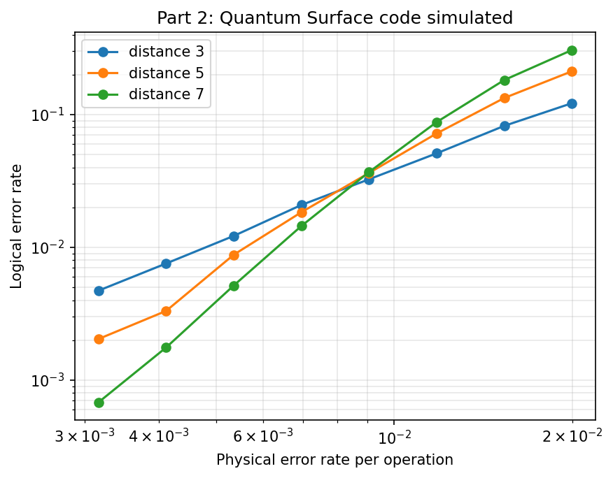

# Simulating Quantum Error Correction in Python

A hands-on exploration of error correction, starting from a classical repetition code and building up to a quantum surface code, simulated with [Stim](https://github.com/quantumlib/Stim) and decoded with [PyMatching](https://github.com/oscarhiggott/PyMatching).

## Why I built this

I build this to further understand error correction! My only glimpse into quantum comupting was just through my knowledge of cybersecurity and encryption. You learn through doing so I created this project to understand the importance of fault tolerance in quantum computing. I have an engineering background so I understand the digital electronics behind this and understand how this would work in hardware.

## Part 1: Classical repetition code
Aim: Protect one bit by copying it *n* times, flip each copy with probability *p*, then decode by majority vote.



**Result:** below p = 0.5, more copies make the decoded bit more reliable. Above it, more copies make things *worse*. That crossover is a **threshold**, the central idea in error correction.

## Part 2: Quantum surface code
Aim: Using Stim, I simulated a rotated surface code memory experiment with noise on gates, measurements and resets, at code distances 3, 5 and 7. PyMatching decoded the error syndromes using minimum-weight perfect matching.



**Result:** the curves cross at a physical error rate of roughly **0.8–0.9%**. Below that, larger codes give lower logical error rates (at 0.3% noise, distance 7 is about 6x more reliable than distance 3). Above it, adding qubits makes things worse. This is why hardware quality and decoding both matter for fault-tolerant quantum computing.

## What I learned
- That error correction works only below a threshold. As pictured above, the threshold is where all the lines meet but once it's passed that point the protection only adds to the noise and flips the order of the lines making result worse
- It is well known how fragile quibits are but it is very noticeable in this project as it is 50x lower than the classical ones
- Why the use of FPGAs are used for decoders in a real-life scenario because the aim is to keep up with the amount od sydromes popping up and they are the hardware algorithm so there's no fun

## Next steps
- Measure decoding time, since real-time QEC must decode faster than errors accumulate

## Run it using these files
```bash
pip install -r requirements.txt
python part1_classical_repetition.py
python part2_surface_code.py
```
